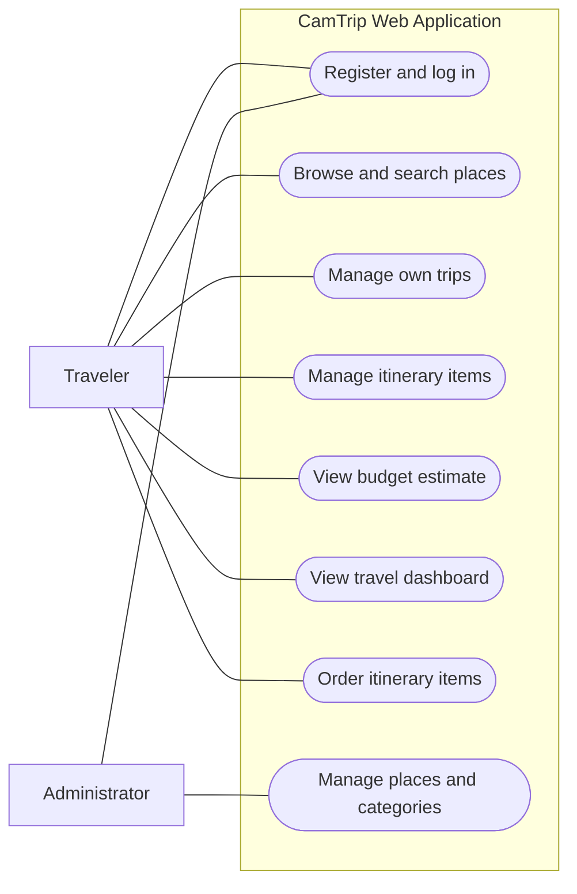
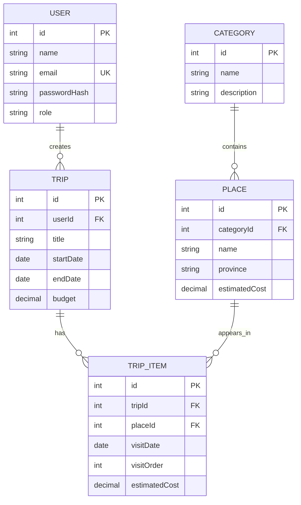
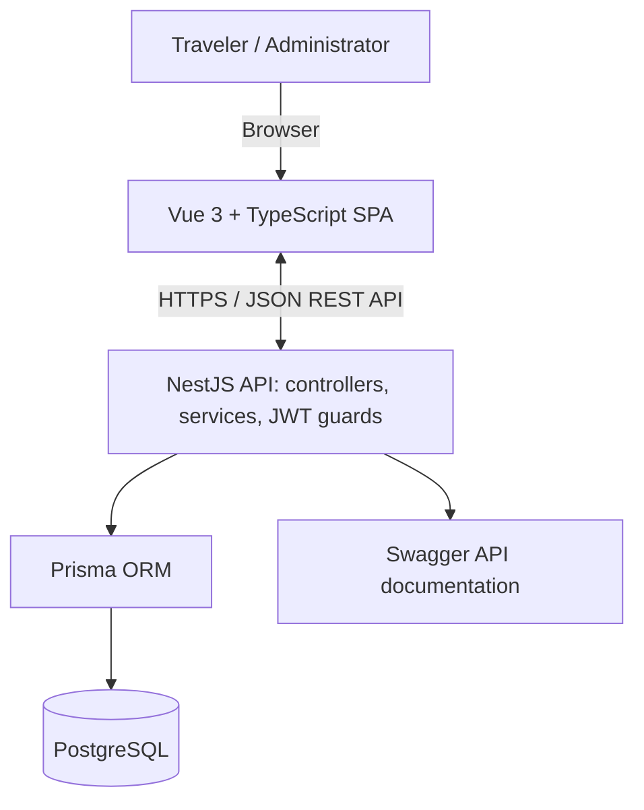
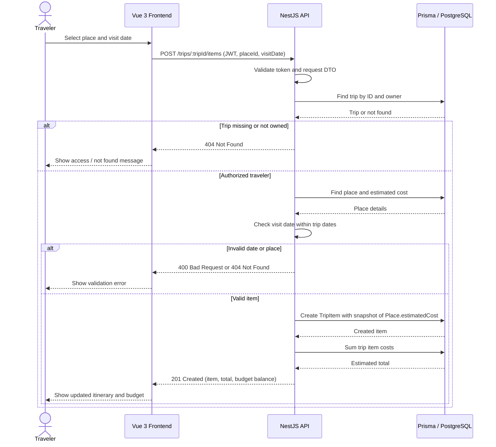

# CamTrip — Cambodia Travel Discovery and Budget Itinerary Planner

## Problem
Travelers in Cambodia often need to search across multiple websites and social media platforms to find information about destinations, activities, and estimated travel expenses, making trip planning time-consuming and difficult to organize. CamTrip addresses this problem by providing a centralized platform where travelers can discover Cambodian destinations, create personalized itineraries, and estimate trip costs based on their selected places and budget.

## Users and roles
- **Traveler:** Registers and logs in; browses and filters places; creates, edits and deletes only their own trips and itinerary items; tracks estimated expenses.
- **Administrator:** Manages destination listings and categories, including descriptions and estimated costs; does not access private traveler itineraries in the MVP.

## Use Case Diagram

The following diagram shows the main responsibilities of each role. Browsing is available to travelers; modifying private trips requires authentication.

## User stories

1. **US-01 — Authentication.** As a traveler, I want to register and log in so that I can securely save and manage my travel plans.
   - Accepted when: a user can register with name, unique valid email and password; passwords are hashed; valid credentials permit login; invalid credentials and protected-page access are rejected.
2. **US-02 — Browse destinations.** As a traveler, I want to browse Cambodian destinations so that I can discover places to visit.
   - Accepted when: destinations show name, province, category and estimated cost; a detail page is available; loading, empty and error states are shown.
3. **US-03 — Search destinations.** As a traveler, I want to search and filter destinations so that I can find places matching my interests and budget.
   - Accepted when: name search and province/category filters work together; results are paginated; empty results have a clear message.
4. **US-04 — Manage trips.** As a traveler, I want to create, edit and delete trips so that I can organize travel plans.
   - **Acceptance criteria (priority domain story):**
     - Given I am logged in as a Traveler, when I submit a title, start date, end date and positive budget, then CamTrip creates a trip owned by my account and displays it in my trip list.
     - Given the end date is before the start date, the budget is zero/negative, or a required field is missing, when I submit the form, then the API rejects it with HTTP 400 and clear validation messages; the frontend displays them.
     - Given I own a trip, when I edit its title, dates or budget, then the updated values are saved and displayed. Changing dates must not leave existing itinerary visits outside the trip range; invalid changes are rejected.
     - Given I own a trip, when I delete it after confirmation, then its itinerary items are removed with the trip and it no longer appears in my list.
     - Given another traveler tries to view, edit or delete my trip by guessing its ID, then the API denies access (404) and does not reveal or modify my private data.
5. **US-05 — Manage itinerary items.** As a traveler, I want to add, update and remove places in a trip so that I can plan what to visit.
   - **Acceptance criteria (priority domain story):**
     - Given I own a trip and select an existing Place with a visit date inside the trip's date range, when I add it, then CamTrip creates a TripItem linked to that trip and place.
     - When the item is created, its `estimatedCost` is copied from the current `Place.estimatedCost` as a saved snapshot.
     - Given a visit date outside the trip range or an invalid cost/order value, when I submit the item, then the API responds with HTTP 400 and a clear message. A nonexistent place returns HTTP 404.
     - Given I own the trip, when I edit an item's visit date, visit order, notes or saved estimated cost, then the new values are saved and the itinerary is shown in visit-date/order sequence.
     - Given I own the trip, when I remove an item, then it disappears from the itinerary and its cost no longer contributes to the trip total.
     - Given another traveler tries to add, change or remove an item in my trip, then the API denies access (404) without changing data.
6. **US-06 — Estimate costs.** As a traveler, I want to see the estimated trip cost so that I can check my budget.
   - **Acceptance criteria (priority domain story):**
     - Given a trip with itinerary items, when I open the trip detail page, then CamTrip displays the sum of its saved `TripItem.estimatedCost` values and the trip budget.
     - Given a trip with no itinerary items, then the estimated total is 0.
     - The balance is calculated as `Trip.budget - sum(TripItem.estimatedCost)`; a negative balance is clearly labeled as over budget.
     - After an item is added, updated or removed, the displayed total and balance are recalculated from saved values.
     - When an administrator updates `Place.estimatedCost`, the costs of existing TripItems do not change automatically; new items use the new Place estimate.
     - All costs are nonnegative decimal monetary values, stored and calculated using decimal arithmetic rather than floating-point arithmetic.
7. **US-07 — Manage places.** As an administrator, I want to manage destinations and categories so that listings remain organized.
   - Accepted when: only admins can create, update and delete places/categories; fields are validated; deletion of referenced places is safely blocked.
8. **US-08 — PDF export.** As a traveler, I want to export an itinerary as a PDF so that I can access or share it offline. **Nice-to-have; not in MVP.**
   - Accepted when (if implemented later): the owner can export their own trip with dates, selected places and budget estimate; other users cannot export private trips.
9. **US-09 — Travel dashboard.** As a traveler, I want to see a summary of my saved trips so that I can quickly open and continue planning one.
   - Accepted when: authenticated travelers see only their own trips, with title, dates, budget and estimated total; an empty state is displayed when no trips exist.
10. **US-10 — Organize itinerary order.** As a traveler, I want to set the order of places within each trip day so that my itinerary is easier to follow.
   - Accepted when: travelers can set a numeric visit order for their own itinerary items; items are displayed by visit date and then order; duplicate order values for the same day are rejected or resolved consistently.

## MVP scope
**Must-have:** US-01 through US-07, US-09 and US-10; Vue 3 SPA with Vue Router and Pinia; NestJS REST API; PostgreSQL/Prisma; JWT and hashed passwords; role and ownership checks; client/server validation; loading/empty/error states; Swagger; unit/e2e tests; Docker Compose deployment; documentation.

**Nice-to-have:** US-08 PDF export, reviews, favorites, maps, rule-based recommendations, group planning. The MVP excludes actual bookings, payments, chat and AI itinerary generation.

## Entities
| Entity | Main attributes | Relations |
|---|---|---|
| User | id, name, email, passwordHash, role, createdAt | Has many Trips |
| Category | id, name, description | Has many Places |
| Place | id, categoryId, name, province, description, estimatedCost, imageUrl | Belongs to Category; has many TripItems |
| Trip | id, userId, title, startDate, endDate, budget, createdAt | Belongs to User; has many TripItems |
| TripItem | id, tripId, placeId, visitDate, visitOrder, estimatedCost, notes | Belongs to Trip and Place |

**Rules:** Unique emails; nonnegative costs; positive trip budget; valid trip date range; itinerary visit dates within trip dates; trip ownership checks; itinerary items ordered by visit date and visitOrder. A trip date change is rejected if it would put existing itinerary items outside the new date range. Deleting a trip also removes its TripItems. Place deletion is blocked when referenced by an itinerary. Place costs are estimates, not guaranteed prices.

### Estimated-cost snapshot decision
`Place.estimatedCost` is the current reference estimate maintained by an administrator. When a traveler adds a place to a trip, CamTrip copies this value into `TripItem.estimatedCost` **once, at creation**. This saved amount is a snapshot for that itinerary item; later changes to the Place estimate do **not** automatically update existing items. A traveler may explicitly edit the saved item estimate (for example, to reflect their own expected spending). The trip total always sums the saved TripItem estimates. This makes saved budgets predictable and avoids silently rewriting existing plans. New itinerary items use the Place's latest estimate. Use PostgreSQL `DECIMAL` via Prisma `Decimal` for monetary values.

### Entity Relationship Diagram (ERD)

## Stretch feature
**Search, filter and pagination.** Travelers can search by destination name and filter by province, category and estimated cost. Example: `GET /places?search=waterfall&province=Kampot&categoryId=1&page=1&limit=10`. The API returns matching results and pagination metadata.

## System Architecture Diagram

The frontend uses Vue Router for navigation and Pinia for shared authentication state. NestJS validates requests and enforces role and ownership rules before Prisma accesses PostgreSQL. Docker Compose runs the stack; Nginx serves as the reverse proxy in deployment.

## Sequence Diagram — Add a Place to a Trip and Update Budget

This sequence illustrates US-05 and US-06, including the ownership check and the response to the frontend. The backend computes totals from saved itinerary-item estimates. On creation, the item estimate is copied from the current Place estimate and then remains independent of later Place price updates.

## Repository
`https://github.com/Mookineii/camtrip`  
**Before submission:** Replace `<your-username>` with your GitHub username and verify the actual repository is named `camtrip` (not `camptrip`). If the real repository has a different name, use its exact URL here instead.

## M0 design explanation
**Which story did you cut from the MVP, and why?**

I cut US-08 (PDF itinerary export) because it is not essential to the core workflow of discovering places, creating trips and calculating estimated expenses. PDF generation adds formatting and file-generation work, so I will prioritize authentication, secure CRUD, planning, tests and deployment, and add export only if time remains.
